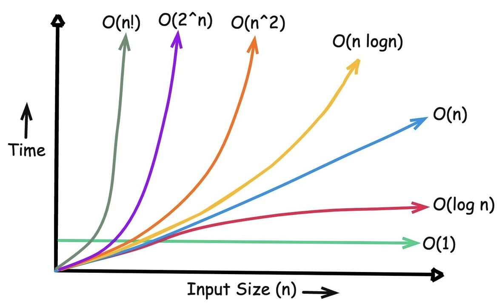

# Time Complexity

## Time Complexity is not the actual time taken to execute the code but the amount of time taken as function of input size (n).

### For example:
```
arr[n];
target = x;

for(int i; i < n; i++){
    if(arr[i]== target){
        return i;
    }
}
return -1
```
so if the input (n) (array size) is 1 than the given codes, for loop will execute or run 1 operation but 

when the input size let say 1 million and the target value is in last index of the array than the loop will run 1 million times which means 1 million operation

+ input n = 1  => 1 operations
+ input n = 10  => 10 operations
+ input n = 10^6 (million)  => 10^6 operations

if we plot this in x vs y graph
+ x represents input size (n)
+ y represents num of operations
+ we get straight line f(n) = n
+ so we get Time complexity O(n) linear Time complexity

> we always calculate the time complexity with worst case senerio (input size (n)++ )

## Big O Notation
### Big O notation is a mathematical tool used in computer science to describe the asymptotic upper bound of an algorithm's time or space complexity as the input size grows.

+ **Upper Bound:** It measures the worst-case growth rate of how long an algorithm takes to run or how much memory it uses.

+ **Dropping Constants:** Multipliers and lower-order terms are ignored because they do not change the long-term scaling trend. for example: O(n^2 + 2n + 5) becomes O(n^2) 

+ **Input Size (n):** It evaluates how performance changes as the amount of data (n) increases.

### Notation
Notation can also 3 different types 
+ **Big O :** Represents worst case senerio (upper bounds)
+ **Big Θ :** Represents Avg case senerio (middle bounds) 
+ **Big Ω :** Represents best case senerio (lower bounds) 


# Space Complexity
### Space complexity is the total amount of memory space an algorithm requires to execute and solve a problem relative to the size of its input.

Space complexity is calculated by combining two distinct types of memory usage:

+ **Input Space:** The memory required to store the standard input data passed into the algorithm.

+ **Auxiliary Space:** The extra or temporary memory allocated by the algorithm during its execution. example: local variables, new data structures, or call stack frames


# Common Time Complexities

How it Grows Real-World Example:



+ **O(1) Constant :** Looking up an element in an array by its index.

+ **O(log n) Logarithmic :** Binary search in a sorted array.

+ **O(n) Linear :** Linear search to find an item in an unsorted list.

+ **O(nlog n) Linearithmic :** Merge Sort or Quick Sort.

+ **O(n²) Quadratic :** Nested loops, like Bubble Sort or Selection Sort.

+ **O(2^n) Exponential :** Recursive Fibonacci sequence.

+ **O(n!) Factorial :**  VERY BAD

### Why it Matters

If you run an algorithm on a dataset of 10,000 elements:

+ An O(n) algorithm takes roughly 10,000 operations.
+ An O(n²) algorithm takes roughly 100,000,000 operations

# Common Time Complexities in Python

## 1. O(1) — Constant Time

**Example:** Accessing an array element by index.

```python
arr = [10, 20, 30, 40, 50]
print(arr[2])  # Output: 30
```

**Note:** The operation takes approximately the same amount of time regardless of the array size.

---

## 2. O(log n) — Logarithmic Time

**Example:** Binary search in a sorted array.

```python
def binary_search(arr, target):
    left, right = 0, len(arr) - 1

    while left <= right:
        mid = (left + right) // 2

        if arr[mid] == target:
            return mid
        elif arr[mid] < target:
            left = mid + 1
        else:
            right = mid - 1

    return -1
```

**Note:** Each iteration halves the search space. The array must be sorted.

---

## 3. O(n) — Linear Time

**Example:** Linear search in an unsorted array.

```python
def linear_search(arr, target):
    for i, value in enumerate(arr):
        if value == target:
            return i
    return -1
```

**Note:** In the worst case, every element is checked once.

---

## 4. O(n log n) — Linearithmic Time

**Example:** Merge sort.

```python
def merge_sort(arr):
    if len(arr) <= 1:
        return arr

    mid = len(arr) // 2
    left = merge_sort(arr[:mid])
    right = merge_sort(arr[mid:])

    result = []
    while left and right:
        if left[0] <= right[0]:
            result.append(left.pop(0))
        else:
            result.append(right.pop(0))

    return result + left + right
```

**Note:** Merge sort divides the array into smaller parts and merges them in sorted order. Its time complexity is O(n log n).

*Implementation note:* This is a simplified demonstration. Using `pop(0)` makes the merging step less efficient in Python; a production implementation should use indices or iterators to achieve O(n log n) time.

---

## 5. O(n²) — Quadratic Time

**Example:** Nested loops.

```python
def print_pairs(arr):
    for i in arr:
        for j in arr:
            print(i, j)
```

**Note:** For every element, the code processes every element again, producing n × n operations.

---

## 6. O(2ⁿ) — Exponential Time

**Example:** Recursive Fibonacci without memoization.

```python
def fibonacci(n):
    if n <= 1:
        return n

    return fibonacci(n - 1) + fibonacci(n - 2)

print(fibonacci(5))  # Output: 5
```

**Note:** The function repeatedly solves overlapping subproblems. Its running time grows exponentially with n.

---

## Quick Revision

| Complexity | Example | Growth |
|---|---|---|
| O(1) | Array index access | Constant |
| O(log n) | Binary search | Logarithmic |
| O(n) | Linear search | Linear |
| O(n log n) | Merge sort | Linearithmic |
| O(n²) | Nested loops | Quadratic |
| O(2ⁿ) | Naive recursive Fibonacci | Exponential |

**Remember:** Big O describes how an algorithm's resource usage grows as the input size increases. These examples describe time complexity, generally focusing on the worst case where applicable.

# Understanding Problem Constraints in DSA

## 1. What Are Constraints?

**Constraints are the limits placed on the input values of a problem.** They tell you the minimum and maximum values that variables can have, helping you determine which algorithms are practical.

For example, a problem might specify:

```text
1 <= n <= 100000
-10^9 <= nums[i] <= 10^9
1 <= target <= 10^9
```

This means:

- `n`: The array contains between 1 and 100,000 elements.
- `nums[i]`: Each array element can range from -1,000,000,000 to 1,000,000,000.
- `target`: The target value can be as large as 1,000,000,000.

**Important:** The maximum input size often matters most when analyzing time complexity, while the range of values can suggest whether you need special data structures or mathematical techniques.

## 2. Why Do Constraints Matter?

Imagine you need to determine whether an array contains two numbers whose sum equals a target.

### Approach A: Brute force — O(n²)

```python
def has_pair_brute(nums, target):
    for i in range(len(nums)):
        for j in range(i + 1, len(nums)):
            if nums[i] + nums[j] == target:
                return True
    return False
```

### Approach B: Hash set — O(n) average time

```python
def has_pair(nums, target):
    seen = set()

    for num in nums:
        if target - num in seen:
            return True
        seen.add(num)

    return False
```

Suppose `n = 100,000`.

| Approach | Approximate work |
|---|---:|
| Brute force | 5 billion pairs in the worst case |
| Hash set | About 100,000 iterations on average |

The second approach is much more practical for a large input.

The lesson: **constraints help you reject algorithms that are too slow before you start coding.**

## 3. Practical Time Complexity Guide

These are approximate starting points, not guaranteed limits. They assume a typical competitive-programming environment and one main input-size variable.

| Maximum `n` | Complexity to consider | Typical techniques |
|---:|---|---|
| `n <= 10` | O(n!), O(2ⁿ) | Permutations, backtracking |
| `n <= 20` | O(2ⁿ), O(n · 2ⁿ) | Subset enumeration, bitmask DP |
| `n <= 100` | O(n³) may work | Triple loops, small DP |
| `n <= 500` | O(n³) may work | Cubic DP, graph algorithms |
| `n <= 1,000` | O(n²) often works | Nested loops, pairwise comparisons |
| `n <= 10,000` | O(n²) may be risky | Sorting, optimized DP |
| `n <= 100,000` | O(n log n) or O(n) | Sorting, hashing, two pointers |
| `n <= 1,000,000` | Usually O(n) or O(n log n) | Prefix sums, hashing, efficient scans |
| `n <= 10⁸` | Usually sublinear or highly optimized | Binary search, mathematical methods |
| `n <= 10⁹` or greater | Often O(log n) or O(1) | Binary search, formulas, number theory |

The smaller-input categories can support other complexities too. For example, an O(n²) algorithm might work for `n = 100`, while O(n³) might be too expensive for `n = 10,000`.

## 4. Understanding Each Constraint in Practice

### A. `n <= 10` — Factorial or exponential algorithms

Very small input sizes can allow exhaustive search.

```python
from itertools import permutations

nums = [1, 2, 3, 4]

for order in permutations(nums):
    print(order)
```

- Complexity: O(n! × n) if processing each permutation takes O(n).
- Common techniques: Permutations, backtracking, exhaustive search.
- Why: There are only 10! = 3,628,800 permutations when `n = 10`.

### B. `n <= 20` — Subsets and bitmasking

```python
nums = [2, 4, 6]
n = len(nums)

for mask in range(1 << n):
    subset = []

    for i in range(n):
        if mask & (1 << i):
            subset.append(nums[i])

    print(subset)
```

- Complexity: O(n · 2ⁿ).
- Common techniques: Bitmasking, subset DP, state compression.
- Why: There are 2ⁿ possible subsets. At `n = 20`, that is 1,048,576 subsets, with additional work to process each subset.

### C. `n <= 100` — Cubic algorithms may be possible

```python
n = 100

for i in range(n):
    for j in range(n):
        for k in range(n):
            pass
```

- Complexity: O(n³).
- Approximate iterations at `n = 100`: 1,000,000.
- Common techniques: Triple-loop enumeration, small dynamic programming problems.

### D. `n <= 1,000` — Quadratic algorithms

```python
n = 1000

for i in range(n):
    for j in range(n):
        pass
```

- Complexity: O(n²).
- Approximate iterations: 1,000,000.
- Common techniques: Pairwise comparisons, simple DP, brute-force pair searches.

This is often a reasonable starting point, but nested loops over 1,000 elements are not automatically safe if their bodies perform expensive work.

### E. `n <= 10,000` — Be careful with O(n²)

```python
n = 10_000

for i in range(n):
    for j in range(n):
        pass
```

- Complexity: O(n²).
- Approximate iterations: 100 million.
- Common techniques: Sorting, binary search, prefix sums, hashing, or optimized DP.

One hundred million iterations can be too slow in Python, especially with additional work inside the loops. Check the time limit rather than assuming this will pass.

### F. `n <= 100,000` — Usually O(n log n) or O(n)

```python
nums = [5, 2, 8, 1, 3]
nums.sort()
```

- Complexity: O(n log n) for Python's sorting algorithm in the worst case.
- Common techniques: Sorting, heaps, hash maps, binary search, two pointers, sliding windows.
- Why: At `n = 100,000`, sorting is generally much more practical than comparing every pair.

### G. `n <= 1,000,000` — Efficient linear processing

```python
def total_sum(nums):
    total = 0

    for num in nums:
        total += num

    return total
```

- Complexity: O(n) time.
- Common techniques: Prefix sums, hash maps, sliding windows, frequency counting.
- Why: A single pass processes one million elements in linear time, although actual runtime still depends on implementation and the judge.

### H. `n <= 10⁸` — Avoid iterating over every value when possible

```python
def count_steps(n):
    steps = 0

    while n > 1:
        n //= 2
        steps += 1

    return steps
```

- Complexity: O(log n).
- Common techniques: Binary search, divide and conquer, mathematical observations.
- Why: An O(n) algorithm may require 100 million iterations, while repeatedly halving the value takes only about 27 iterations for `n = 10⁸`.

### I. `n <= 10⁹` or greater — Look for mathematical solutions

```python
def sum_first_n(n):
    return n * (n + 1) // 2
```

- Complexity: O(1) time, assuming fixed-cost arithmetic.
- Common techniques: Formulas, number theory, binary search, mathematical reasoning.
- Why: A loop running one billion times is usually impractical when a direct formula solves the same problem.

Python supports arbitrary-precision integers, so arithmetic on extremely large integers is not literally constant-time. O(1) here refers to the number of arithmetic operations.

## 5. Constraints Are More Than Just `n`

You should inspect every constraint, not only the array length.

### A. Value range

Example:

```text
1 <= n <= 100000
1 <= nums[i] <= 10^9
```

A direct frequency array indexed by `nums[i]` could require one billion positions. A hash map or sorting may be more appropriate.

### B. Number of test cases

Example:

```text
1 <= t <= 1000
1 <= n <= 1000
```

If every test case has `n = 1000`, an O(n²) algorithm performs roughly:

`t × n² = 1000 × 1,000,000 = 1,000,000,000` operations.

That is likely too slow.

### C. Sum of input sizes

You may see:

```text
The sum of n over all test cases does not exceed 200000.
```

This is an important limit. It means the total number of array elements across all test cases is at most 200,000.

An O(n) solution per test case can then process O(200,000) elements in total, rather than necessarily processing 200,000 elements in every test case.

However, if each test case requires O(n²), the total work is the sum of each test case's squared input size, not simply the square of the total.

### D. Memory constraints

Example:

```text
Memory limit: 256 MB
```

A solution might be fast enough but use too much memory.

Consider:

- A Python integer and list entry use substantially more memory than a raw 4-byte integer.
- A two-dimensional DP table can consume O(n²) memory.
- A hash map usually has additional memory overhead.
- An in-place algorithm may reduce extra memory usage.

Always consider both **time complexity and space complexity**.

## 6. How to Estimate Runtime

A common competitive-programming rule of thumb is that approximately 10⁷–10⁸ simple operations per second may be possible in some environments. This is not a guarantee, and Python may be slower for particular operations.

For example, if `n = 100,000`:

| Complexity | Approximate scale |
|---|---:|
| O(log n) | 17 |
| O(n) | 100,000 |
| O(n log n) | 1.7 million |
| O(n²) | 10 billion |
| O(2ⁿ) | Impractical |

These numbers represent rough operation counts, not exact execution times. O(n log n) is approximately 100,000 × 17 here.

## 7. A Practical Checklist Before Coding

1. **Read all constraints.** Identify the maximum input sizes and value ranges.
2. **Check the time and memory limits.**
3. **Develop a brute-force solution mentally.** Understand what it does and calculate its complexity.
4. **Estimate the worst-case work.** Account for nested loops, recursion, test cases, and expensive operations.
5. **Choose a suitable approach.** Consider hashing, sorting, binary search, two pointers, greedy algorithms, or dynamic programming.
6. **Analyze time and space complexity.**
7. **Test the largest possible inputs.** Small examples alone cannot expose every performance problem.

## Final Rule

**Constraints do not tell you the exact algorithm to use. They help you identify which algorithms are feasible.**

Use them alongside the problem's structure, time limit, memory limit, and the complexity of the operations you perform.

For further reading:

- [Codeforces — How to determine a solution by looking at constraints](https://codeforces.com/blog/entry/21344)
- [Codeforces — A Time Complexity Guide](https://codeforces.com/blog/entry/104888)
- [LeetCode — Solving problems using constraints](https://leetcode.com/discuss/post/1105473/solving-problems-with-aid-of-problem-constraints/)

